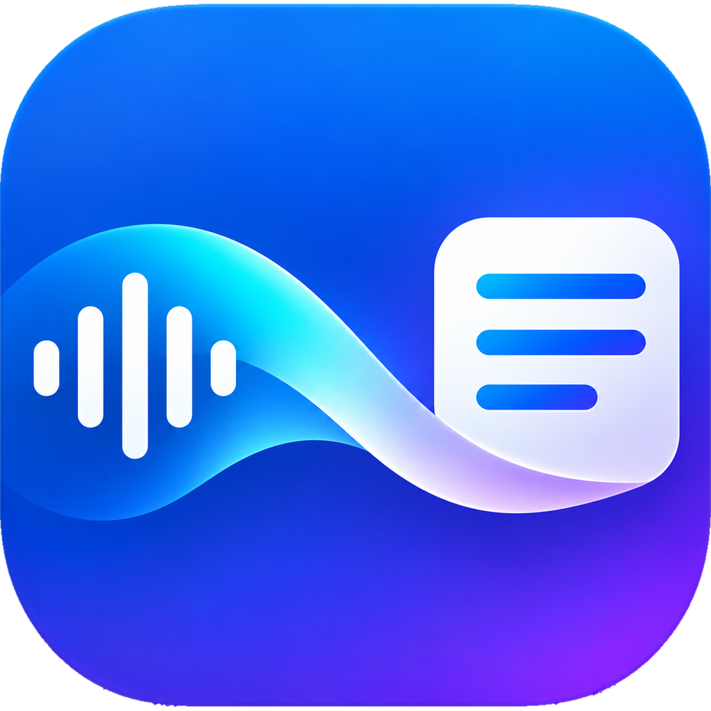
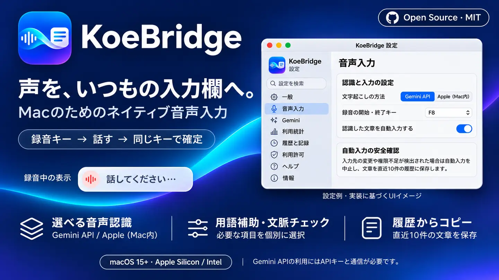

# KoeBridge 🎙️






**Google AI Proなどの特典で、利用可能なGoogle Cloudクレジットが余っている人にも。**  
macOSのための、**超軽量を目指したオープンソース音声入力アプリ**です。

> **録音キー → 話す → 同じキーで確定。** 文字起こし結果を、元の入力欄へ直接送ります。  
> Swift製のネイティブなメニューバーアプリ。Electron・Webブラウザー・Python常駐サーバーは不要です。

**v1.1.2（ソースコード＋開発版アプリ）/ MIT License / 自由に改造・再配布OK**（ライセンス表示の維持が条件）

## ダウンロード — v1.1.2

[開発版アプリをダウンロード（Universal ZIP）](https://github.com/ma-do-ka/KoeBridge/releases/download/v1.1.2/KoeBridge-v1.1.2-macOS-universal-development.zip) / [リリースノート・SHA-256](https://github.com/ma-do-ka/KoeBridge/releases/tag/v1.1.2)

macOS 15以降、Apple Silicon・Intel向けです。**このZIPはアドホック署名の開発版で、Developer ID署名・Apple公証はありません。** KoeBridgeを終了してから展開し、既存版を退避してアプリを置き換えてください。OSが起動を止める場合はmacOSの通常の「プライバシーとセキュリティ」の案内に従ってください。更新後にマイク・アクセシビリティなどの再許可が必要になる場合があります。OSの保護を一括で無効化する操作は不要です。

手元の署名証明書によるビルドを継続する場合は、下のソースビルド手順を使ってください。自動インストールは行いません。

## こんな人向け

- Google AI Pro契約者で、**Gemini APIに適用可能な**Google Cloudクレジットを活用したい人
- ChatGPT・ブラウザー・エディターなどで、日本語の音声入力を使いたい人
- 大きな常駐アプリを避け、ローカルのSwiftコードを自分好みに変更したい人
- クラウド音声認識を使わず、Appleオンデバイス認識を選びたい人

**重要：Google AI Proへの加入だけでGemini APIが無制限・無料になるわけではありません。** Google AI ProにはDeveloper Program特典として月額10米ドル相当のGoogle Cloudクレジットが案内されていますが、*そのクレジットがGemini APIの利用料金に充当されるか* は、種類・利用条件・請求先の紐付けに依存します。無料トライアル/ウェルカムクレジットはGemini API対象外の場合があります。前払い設定を要求されるケースもあります。必ず本人のGoogle AI Studio / Cloud Billing上で確認してください。料金を自動制限する機能はありません。

## 主な機能

最新更新： [v1.1.2 リリースノート](docs/releases/v1.1.2.md)。入力失敗の段階、macOSの応答、入力先・選択位置の照合、送信後の確認、前の録音との関係を、既存の「問題調査用の記録を残す」がONのときだけ記録します。本文・音声・APIキー・ウィンドウ名・URLは記録しません。カーソルの移動と取得不能を区別し、短いAX問い合わせ時間の設定がプロセス全体に残る経路を修正しました。[調査記録の説明](docs/input-diagnostics.md)。実環境での個別の失敗原因は再発時の記録で調査します。

v1.1.1： [リリースノート](docs/releases/v1.1.1.md)。録音・文章チェック・履歴保存・設定画面の責務を整理し、保存失敗時の統計欠落、キャンセル後の遅延通知、設定内検索とAPIキー削除の不具合を修正しました。

v1.1.0： 確定直後の連続録音で、自分自身の入力によるカーソル移動を後続へ引き継ぎます。Geminiの発話区間は録音開始・停止で明示し、自然な間だけで区切らない方式へ変更しました。用語補助と追加チェックは独立チェックボックスで選べます。

v1.0.1f以前： メニューバーの「認識履歴（直近10件）」にマウスを重ねると保存した文字起こしのサブメニューを開きます。項目を選択すると全文をクリップボードにコピーし、画面に成否を表示します。従来の履歴画面はサブメニュー最下部から開けます。メニューバーから更新確認を選んだ際、設定画面の初回表示でもアップデート欄まで移動するよう改善。メニューバーからの更新確認、GitHub Stableリリースの自動確認、更新コマンドの案内を追加。「一般」から認識方法・録音キー・自動入力・文字起こしスタイルを直接変更できます。


v1.0.1bの変更点： [GitHubリリースノート](docs/releases/v1.0.1b.md)。旧「話した内容を読みやすく整える」は「文字起こしスタイル」に置換しました。旧設定ON→「読みやすく」、OFF→「逐語」で引き継ぎます。「AIエージェント指示」はGemini LiveのVERBATIMを使い、スタイルの選択自体では別のLLM呼び出しを追加しません。

| 機能 | 内容 |
| --- | --- |
| Gemini音声認識 | Gemini 3.5 Transcribe LiveをWebSocketで利用（APIキーが必要） |
| Appleローカル認識 | macOSのオンデバイス音声認識へ切替可能（対応環境のみ） |
| ショートカット | 同じキーで録音開始・停止。F8、右Commandなどを設定から選択 |
| 自動入力 | 元の入力先が維持されている場合に直接入力を試みる。入力先が変わった場合は中止 |
| 認識履歴 | 直近10件を端末内に保持。入力失敗時はコピー可能 |
| Gemini辞書 | 専門用語のヒントを設定可能 |
| AIエージェント指示モード（v1.0.1b） | 発言の条件・コマンド・技術用語をできるだけ残す逐語認識。補助辞書は個別チェックで選択。最小限の段落整形を追加。完全一致は保証されません |
| 診断ログ | **初期OFF**。設定画面でON、上限約384KiB、手動削除可能 |
| 利用統計 | Gemini/Appleの処理回数・処理PCM秒数・成功/失敗・切替、Geminiが返したトークン数を1分/1時間/1日単位で表示 |
| 設定画面の説明文 | すべての項目に意味と注意点を表示。名称と操作はわかりやすい日本語に統一 |
| 設定サイドバー | 「基本」「データと安全」「サポート」の8画面。設定名の検索・戻る／進む・ヘルプ・情報を追加 |
| GitHubの正式版の更新確認（v1.0.1d） | メニューバーの「アップデートを確認…」、設定→情報→アップデート。自動確認は最大1日1回。新しい正式版ではソース更新用の検証付きコマンドをコピー可能。公証済み更新パッケージがないため自動インストールは未提供 |
| ログイン時に自動起動（v1.0.1cで改善） | 設定→一般のONでmacOSへの登録を試行。サービスが見つからない状態でも登録操作を試せます。承認待ちならOS設定を開き、ユーザーが許可します。登録できない場合は手動追加を案内 |
| 録音停止後のフィードバック | 確定処理中も非アクティブのパネルを表示。送信／履歴保存／失敗を正しく区別し、次の録音を妨げない |
| 応答性調整 | 音声チャンクを50msに短縮し、確定判定の確認間隔を75ms→25msへ短縮。安全上の確定条件は維持。実機での速度改善量は未計測 |
| 連打・短い無音の終了 | 誤って録音キーをすぐに再押下した場合、音声・途中結果・欠落の有無を確認し、空入力なら短い「音声入力なし」表示で終了。通常の音声認識エラーは維持 |

※ アプリ側が合成キー入力を受理しない場合があります。どのアプリにも必ず自動入力されるわけではありません。

## ゼロからインストール・アプリ生成（コマンド付き）

**対象：Apple Silicon・Intel / macOS 15以降。** 以下はソースから自分のMac用にビルドする方式です。以下のコマンドはMacの「ターミナル」で実行してください。

### Step 1 — 開発環境を準備

```bash
# Command Line Toolsを未導入の場合だけ実行（画面の案内に従う）
xcode-select --install

# インストール状態を確認
xcode-select -p
swift --version
git --version
```

`xcode-select --install` が「既にインストールされています」と表示されたら再インストールは不要です。Swift 6系を推奨します。`swift --version` が失敗する場合はXcodeまたはCommand Line Toolsの選択状態を確認してください。

### Step 2 — リポジトリを取得

```bash
cd ~
git clone https://github.com/ma-do-ka/KoeBridge.git
cd KoeBridge
```

**既に `~/KoeBridge` がある場合**、cloneを繰り返して既存のコードを上書きしないでください。更新前に自分の変更をバックアップしてください。

### Step 3 — テストと .app の生成

```bash
# Swift Testingの単体テスト
swift test --parallel

# ポータブルな自己テスト
swift run -c release KoeBridgeSelfTest

# ビルド・署名検証・アプリ起動
bash scripts/verify_and_build.sh --open
```

ビルド後のアプリ：`dist/KoeBridge.app`。**アップロードされた新アイコン（`Resources/KoeBridge_AppIcon.icns`）をアプリに同梱し、署名前に元ファイルとのSHA-256一致を確認**します。Finderやアプリ切替時のアプリアイコンと設定画面左上のブランドアイコンに反映されます。メニューバーはmacOSの表示に馴染むモノクロの波形アイコンのままです。`verify_and_build.sh` は署名証明書がない場合、自動的に不安定なアドホック署名へ切り替えず停止します。**証明書がない開発・個人テスト用途のみ**、次を明示的に実行できます。

```bash
KOEBRIDGE_ALLOW_ADHOC=1 bash scripts/verify_and_build.sh --open
```

アドホック署名ではビルド更新後にmacOSの各種許可を再設定する場合があります。OSのセキュリティ機能を無効にする必要はありません。

アプリが生成されたか確認・再起動する場合：

```bash
ls -ld dist/KoeBridge.app
open dist/KoeBridge.app
```

### Step 4 — APIキー・権限・音声入力

1. メニューバーの **KoeBridge → 設定… → 音声入力** で「文字起こしの方法」と「録音の開始・終了キー」（例：F8）を選びます。
2. Geminiを使う場合は、[Google AI Studio](https://aistudio.google.com/apikey)で**自分のAPIキー**を作成します。アプリの **設定… → Gemini → Gemini APIキー → APIキーを保存** から登録してください（macOSキーチェーン保存）。AppleオンデバイスならAPIキー不要です。
3. **設定… → 利用許可** でマイク・アクセシビリティ・入力イベント送信の状態を確認します。右Commandなどの単独修飾キーには入力監視の許可が必要な場合があります。
4. メモやChatGPTの**入力欄をクリック** → 録音キー → 話す → 同じキーで停止。対象アプリが受理すれば、認識した文字が入力されます。

## 設定画面（mainブランチ）

左サイドバーから「一般」「音声入力」「Gemini」「利用統計」「履歴と記録」「利用許可」「ヘルプ」「情報」を選べます。検索欄では実在する設定名・関連語を検索できます。上部の矢印は設定画面の戻る／進むです。各ページでは下に続きがある場合にスクロール案内を表示し、最下部で非表示になります。macOSのスクロールバー表示設定に関係なく案内が使えます。

「一般」では認識エンジン・録音キー・自動入力・Gemini文字起こしスタイルを直接変更でき、利用許可とAPIキーの不足、ログイン時の自動起動、更新状況も確認できます。「ヘルプ」は本アプリに実装された操作と対処方法を案内し、「情報」は実際のアプリバージョンと公式リポジトリを表示します。「利用許可」の「再確認」を押すと、許可状態の読み直し結果をその場で表示します。macOSの許可そのものは変更しません。

**録音停止後のパネル：** 録音キーをもう一度押すと録音を止めますが、文字起こしの確定中はパネルを表示し続けます。 誤連打などの極短時間・無音録音は「音声入力なし」と表示してすぐ消えます。確定結果のキー入力を送信した場合は「入力イベントを送信しました」と表示します。これは受信アプリによる入力受理を保証しません。次の録音キー操作は従来どおり直ちに受け付け、古い処理結果が新しいパネルを消さないようにしています。実際の録音／確定処理時間は「一般」の直近の処理時間で確認できます。

### Macでmain最新版を反映する

**KoeBridgeをメニューバーから終了してから**実行してください。既存の `~/KoeBridge` がGitリポジトリでない場合は、既存フォルダをバックアップしてから公式リポジトリを取得します。既存の作業やアプリを無断削除しません。

```bash
set -e
if ! git -C "$HOME/KoeBridge" rev-parse --is-inside-work-tree >/dev/null 2>&1; then
  if [ -e "$HOME/KoeBridge" ]; then
    mv "$HOME/KoeBridge" "$HOME/KoeBridge.backup.$(date +%Y%m%d-%H%M%S)"
  fi
  git clone --branch main https://github.com/ma-do-ka/KoeBridge.git "$HOME/KoeBridge"
fi
cd "$HOME/KoeBridge"
origin="$(git remote get-url origin)"
case "${origin%.git}" in
  https://github.com/ma-do-ka/KoeBridge|git@github.com:ma-do-ka/KoeBridge) ;;
  *) echo "ERROR: originが公式KoeBridgeではないため中断します: $origin"; exit 1 ;;
esac
git switch main
git pull --ff-only origin main
bash scripts/verify_and_build.sh --open
```

この処理で更新されるアプリは `~/KoeBridge/dist/KoeBridge.app` です。別の場所のアプリは自動更新されません。Swift Testingがローカルで利用できない場合、検証スクリプトはポータブル自己テストに切り替えます。GitHub Actionsでは完全なSwift単体テスト・Releaseビルド・署名検証を実行します。証明書がない環境では安全のためビルドを止めます。

## How-to（やりたいこと別の操作）

| やりたいこと | 実際の場所・コマンド |
| --- | --- |
| 録音キーをF8などに変更 | `設定… → 音声入力 → 録音の開始・終了キー` |
| 自動入力を停止 | `設定… → 音声入力 → 認識した文章を自動入力する`をOFF |
| APIキーを追加・変更 | `設定… → Gemini → Gemini APIキー → APIキーを保存` |
| APIキーを削除 | `設定… → Gemini → Gemini APIキー → APIキーを削除` |
| 日本語優先・文章の整形を変更 | `設定… → Gemini → 文字起こしの調整` |
| 専門用語を登録 | `設定… → Gemini → 文字起こしの調整 → 固有名詞・専門用語を登録`（1行1語） |
| Appleオンデバイス認識に変更 | `設定… → 音声入力 → 文字起こしの方法` |
| 自動入力に失敗した文章をコピー | メニューバー → `認識履歴（直近10件）…` |
| 問題調査用の記録ON/OFF（初期OFF） | `設定… → 履歴と記録 → 問題調査用の記録を残す` |
| ログだけ削除 | `設定… → 履歴と記録 → 動作記録を削除` |
| コード変更後に再ビルド | KoeBridgeを終了して `bash scripts/verify_and_build.sh --open` |
| テスト | `swift test --parallel` と `swift run -c release KoeBridgeSelfTest` |

**好きに改造してOK：** `Sources/KoeBridge/` が画面・音声入力等のmacOSアプリ、`Sources/KoeBridgeCore/` が共通処理、`Tests/` がテストです。MITライセンスに従って改造・フォーク・再配布・商用利用が可能です（著作権表示とライセンス文を維持してください）。

## Q&A / FAQ

**Q. Google AI ProならGemini APIが完全無料ですか？**  
A. いいえ。Google AI Proの開発者特典には月額$10相当のクレジットが案内されていますが、実際のAPI利用への適用はクレジット種別・請求先の紐付け・前払い方式によります。公式の[特典](https://developers.google.com/profile/help/benefits?hl=ja)・[課金ルール](https://ai.google.dev/gemini-api/docs/billing?hl=ja)を確認してください。KoeBridgeには支出上限を自動設定する機能はありません。

**Q. トークンやクレジットの残高をKoeBridgeから確認できますか？**  
A. できません。Google AI Studio / Cloud Billing側で使用量と請求状況を確認してください。

**Q. APIキーをソースやコマンドに貼る必要はありますか？**  
A. 不要です。キーは`設定… → Gemini`で入力し、macOSキーチェーンへ保存します。Issue・スクリーンショット・GitHubにキーを掲載しないでください。

**Q. F8で録音が始まりません。**  
A. macOSのファンクションキー設定・他アプリとの競合・必要な入力監視権限を確認し、`設定… → 音声入力`で別キーも試してください。

**Q. 認識はできるのにChatGPTやChromeへ文字が入りません。**  
A. `設定… → 利用許可`で許可を確認し、録音開始前に入力欄を選択してください。途中で入力先が変わった場合は誤入力防止で中止します。一部アプリは合成キー入力に対応しないため、直近10件の認識履歴からコピーできます。

**Q. マイクやアクセシビリティを再び許可する必要がありますか？**  
A. macOSの「システム設定 → プライバシーとセキュリティ」で確認してください。アプリ側ではOSの許可を強制できません。コード署名の変更やアドホック署名への切替で再許可が必要になる場合があります。

**Q. Appleオンデバイス認識ならAPIキーは不要ですか？**  
A. 不要です。対応する言語・端末内モデルが必要です。Geminiモードの音声はGoogle APIへ送信されます。

**Q. ログは肥大化しますか？認識本文も記録されますか？**  
A. 診断ログは初期OFFで、ONの場合もサイズ上限があります。認識履歴はログとは別に、最大10件がMacに平文で保存されます。不要な履歴は履歴画面から削除してください。

**Q. 完成済みインストーラーや動作保証はありますか？**  
A. 公証済みの`.dmg`はありません。macOS実機での全環境の動作確認も完了していません。`TEST_REPORT.md`に検証範囲を記載しています。


## Google AI Proのクレジットを使う前のチェック

1. [Google Developer Programの特典](https://developers.google.com/profile/help/benefits?hl=ja)で自分のプラン・クレジットを確認します。
2. [Google AI StudioのAPIキー](https://aistudio.google.com/apikey)を作成し、**そのプロジェクト**が使うCloud Billingの請求先を確認します。
3. [Gemini APIの請求・クレジット適用条件](https://ai.google.dev/gemini-api/docs/billing?hl=ja)を確認します。特に前払い方式ではクレジット適用に別の前払いが必要なことがあります。
4. [Gemini APIの利用量](https://aistudio.google.com/)で実際のトークン使用量・料金を確認します。モデルごとの料金と無料枠は変動します。

KoeBridgeがクレジット残高を読み取る機能はありません。**「AI Proに入っている＝このアプリのAPI料金がゼロ」とは表明していません。**

## API利用料金の概算とローカル集計

KoeBridgeが使うGemini 3.5 Transcribe Liveの有料枠の参考料金は、**典型的な文字出力を仮定して約$0.009/分**です。参考為替1ドル＝158円なら **約1.42円/分・約14円/10分・約85円/60分**（無料枠・クレジット適用前、実請求額ではありません）。

Macに保存された利用統計を、認識本文やAPIキーを表示せず日別に集計できます。外部通信・ファイル書き換えは行いません。

~~~bash
cd "$HOME/KoeBridge"
python3 scripts/estimate_usage_cost.py --days 30 --usd-jpy 158
~~~

開発者のKoeBridge単独の利用実績では、2026年11月6日19:14（JST）時点で**割引前39.10円、クレジット相殺後0円**でした。11月5日単独ではBilling計上29.11円・ローカル記録15.80分であり、標準単価の試算と差があります。請求反映遅延があるため、日付・利用期間を揃えずに合計額を直接比較しません。

**[料金目安の根拠・試算条件・実際の請求との違い](docs/cost-estimate.md)**

## プライバシーとセキュリティ

- **実際のAPIキーは同梱されません。** 初回利用時に設定画面から自分のキーを登録してください。
- Geminiモードでは音声をGoogle APIへ送信します。AppleオンデバイスモードではAppleの対応する端末内音声認識を利用します。
- 認識履歴は `~/Library/Application Support/KoeBridge/recent-transcripts.json` に保存されます。**平文**なのでMacアカウントとバックアップの保護に注意してください。
- 診断ログ `~/Library/Logs/KoeBridge.log` は初期OFF。設定画面 **「履歴・記録」→「問題調査用の記録を残す」** でON/OFF、**「動作記録を削除」** で削除できます。
- 自動入力はOSのアクセシビリティ・入力イベント送信権限に依存し、対象アプリの仕様上動作しない場合があります。
- `.gitignore` と公開前スキャンを同梱しています。**自分のAPIキー、ログ、認識履歴、証明書、環境変数ファイルはGitHubへアップロードしないでください。**

詳しくは [SECURITY.md](SECURITY.md) を参照してください。

## 軽量化の考え方

- Swift + Apple標準フレームワーク中心のネイティブ構成
- Electron、常駐Webサーバー、別途Pythonランタイムなし
- 診断ログ通常OFF、上限付き／不必要な診断観測を省略
- ローカル履歴は最大10件、録音データのファイル保存をしない設計

※ **メモリ使用量やCPU負荷の他製品との比較測定は未実施**です。「超軽量」は設計方針であり、測定済みの性能保証ではありません。

## 開発・改造

ソース: [`Sources/KoeBridge/`](Sources/KoeBridge/) / 共通ロジック: [`Sources/KoeBridgeCore/`](Sources/KoeBridgeCore/) / テスト: [`Tests/`](Tests/)。

```bash
swift test --parallel
swift run -c release KoeBridgeSelfTest
```

GitHub ActionsではmacOS上でSwiftテスト・ビルドを行う設定を用意しています。ただし**CIが実行されるまではmacOSでの成功を確認できません**。プロジェクト所有者向けの安全な新規公開スクリプトは `scripts/publish_to_github.sh` にあります（`ma-do-ka` アカウント専用）。

改造、フォーク、再配布、商用利用も **MITライセンス**に従い自由です。個人利用向けの実験的なアプリなので、使いやすいように好きに変えてください。

## バージョンと既知の制限

- v1.0.0：設定画面を4タブに整理、メニューの操作不能行を削除、ログ初期OFF・容量制限、スリープ等での誤入力対策。
- 公開時にmacOS CIでSwiftテスト・アプリのビルド・署名整合性を検証します。**Gemini実通信、ユーザーのマイク、Chrome・Electron等への実際の入力、起動時のOS承認は実機での確認が必要です。**
- 詳細：[`V100_RELEASE_NOTES.md`](V100_RELEASE_NOTES.md) / [`TEST_REPORT.md`](TEST_REPORT.md)

---

GitHub公開版の更新履歴： [v1.0.1 リリースノート](docs/releases/v1.0.1.md)。署名・公証済みインストーラーはありません。

**KoeBridge はGoogle・Appleとは無関係の個人開発プロジェクトです。** Gemini・Appleの各商標はそれぞれの権利者に帰属します。