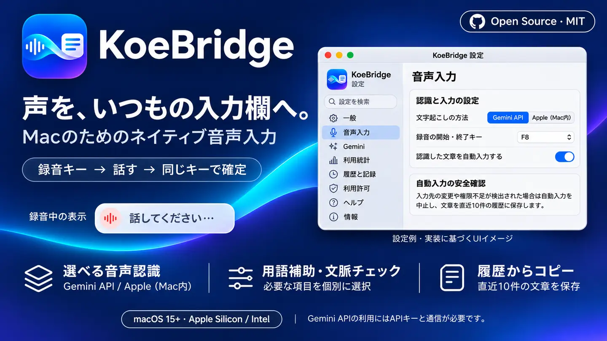

<p align="center"></p>

<h1 align="center">KoeBridge</h1>
<p align="center"><strong>Your voice, in the text field you're using.</strong><br />A native Swift menu-bar dictation app for macOS.</p>
<p align="center"><strong>macOS 15+</strong> · <strong>Apple Silicon / Intel</strong> · <a href="LICENSE">MIT License</a> · <a href="README.md">日本語</a></p>
<p align="center"><a href="#download">Download</a> · <a href="#quick-start">Quick start</a> · <a href="#features">Features</a> · <a href="#when-text-doesnt-appear">Troubleshooting</a> · <a href="#build-from-source">Build</a></p>

## Download

**[KoeBridge v1.1.2 (Build 28) — Universal macOS ZIP](https://github.com/ma-do-ka/KoeBridge/releases/download/v1.1.2/KoeBridge-v1.1.2-macOS-universal-development.zip)**  
[Release details](https://github.com/ma-do-ka/KoeBridge/releases/tag/v1.1.2) · [SHA-256](https://github.com/ma-do-ka/KoeBridge/releases/download/v1.1.2/SHA256SUMS.txt)

> [!IMPORTANT]
> This is an **ad-hoc-signed development build, not Developer ID signed or Apple-notarized**. Quit KoeBridge and back up your existing app before replacing it. macOS may require privacy permissions again. There is no need to disable macOS protections globally.

## Quick start

1. Select the text field in your notes app, browser, editor, or chat.
2. Press your configured recording shortcut (for example, F8) and speak.
3. Press the same shortcut again to finish. KoeBridge attempts to type into the original field.

You can begin another recording immediately after stopping the previous one. If the original target changes or cannot be verified, automatic typing is blocked to avoid misdirected or duplicated text. You can copy the transcript from the **last ten local history entries**. Automatic typing is not guaranteed in every app.

## Features

| Feature | What it does |
| --- | --- |
| Speech engines | Gemini 3.5 Transcribe Live (your API key and internet required) or Apple on-device recognition on supported Macs |
| Dictation controls | One shortcut starts and stops recording; selectable keys include F8 and right Command |
| Continuous dictation | Starts another take immediately; preserves result order and checks destination safety |
| Transcription style | Verbatim, readable, or AI-agent instruction formatting; no accuracy guarantee |
| Terminology assistance | Independent options for registered terms and developer/IT terms |
| Context review | Optional limited punctuation cleanup or additional audio comparison; re-recognition uses extra API time and charges |
| History and usage | Last ten transcript entries, local usage statistics, copy-to-clipboard recovery |
| Opt-in diagnostics | Records focus checks, AX error codes, event posting, and read-back outcomes without saving transcript content |

This is a native Swift app and needs no Electron runtime or always-on Python/web server. Relative speed, CPU use, and memory use have not been benchmarked against competitors.

## Settings

Open **KoeBridge → 設定…** from the menu bar:

- **音声入力**: Recognition engine, recording key, automatic typing.
- **Gemini**: API key (saved in macOS Keychain), transcription style, terminology assistance, context checks.
- **利用許可**: Microphone, Accessibility, event-posting and related permission status.
- **履歴と記録**: Local history and opt-in troubleshooting records (default OFF).
- **利用統計**: Attempt counts, submitted audio duration and available token reports.
- **情報**: Update checking; automatic installation is not provided.

## When text doesn't appear

1. Click the desired text field **before starting recording**. Check whether focus changed during dictation.
2. Open **設定 → 利用許可** to inspect Accessibility and event-posting permissions; they may need reapproval after replacing an ad-hoc-signed app.
3. Recover the recognized text via **認識履歴（直近10件）…** in the menu bar.
4. For recurring failures, turn on **設定 → 履歴と記録 → 問題調査用の記録を残す**. Reproduce the problem and inspect `~/Library/Logs/KoeBridge.log` (and `.log.1` if present). See the [diagnostic guide](docs/input-diagnostics.md).

Diagnostics remain off by default, store up to approximately 384 KiB across two rotated files, and **do not log transcripts, input-field contents, audio, API keys, window titles, or URLs**. Logs are not uploaded automatically. A trace from the affected Mac is required to establish the actual cause of an intermittent failure.

## API cost and privacy

Gemini mode uploads microphone audio to the Google API and may incur usage fees. Apple's on-device mode, where supported, does not require a Gemini API key. Google AI Pro membership alone does not imply free or unlimited Gemini API access; check your actual billing eligibility. KoeBridge does not set an automatic API spending limit.

Transcript history retains up to ten **plaintext** entries locally; protect your Mac account and backups. Recording audio is not stored in that history file. See [cost estimates](docs/cost-estimate.md) and [security details](SECURITY.md).

## Build from source

On macOS with Swift/Xcode Command Line Tools installed:

```bash
git clone https://github.com/ma-do-ka/KoeBridge.git
cd KoeBridge
bash scripts/verify_and_build.sh --open
```

The script runs tests, builds and verifies `dist/KoeBridge.app`. It normally requires an appropriate signing identity; for **local development testing only**, explicitly allow an ad-hoc signature:

```bash
KOEBRIDGE_ALLOW_ADHOC=1 bash scripts/verify_and_build.sh --open
```

For separate test runs:

```bash
swift test --parallel
swift run -c release KoeBridgeSelfTest
```

See [test coverage and limitations](TEST_REPORT.md). CI cannot establish that each user's microphone, Gemini connection, macOS permissions or target editor will work.

## Recent changes

- [v1.1.2](docs/releases/v1.1.2.md): Opt-in input-failure diagnostics, clear AX-unavailable vs. actual selection/focus changes, restored AX messaging timeout.
- [v1.1.1](docs/releases/v1.1.1.md): Refactoring and recovery/cancellation fixes.
- [v1.1.0](docs/releases/v1.1.0.md): Continuous dictation, explicit activity start/end, independent assistance switches.

[All releases](https://github.com/ma-do-ka/KoeBridge/releases) · [Japanese README](README.md)

---

**MIT License** — You may fork, modify and redistribute while retaining the required notices. KoeBridge is an independent project and is not affiliated with Google or Apple.
